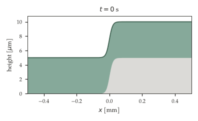
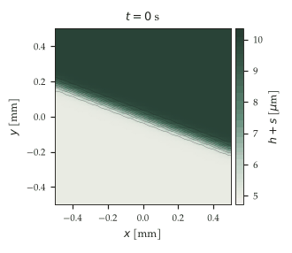
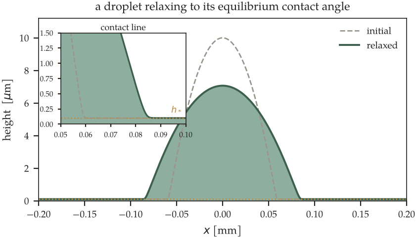
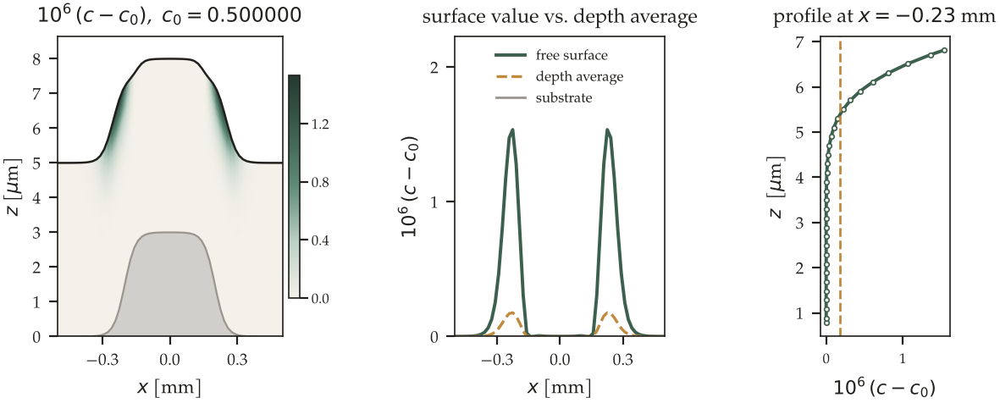

**A thin liquid film flow solver based on the lubrication approximation.**

Yuzen computes how a thin liquid layer on a substrate evolves: how it levels
under surface tension, how it is driven by gravity and rotation, how the
solvent evaporates and the film thickens and solidifies, and how the contact
line advances or recedes.

The name is written 釉然 (*Yuzen*): 釉 (*yū*) is the glaze on a ceramic, and
然 (*zen*) means "as it is, of itself".

Physical processes it can include, each switched on by its own input block:

- capillary (Laplace) pressure
- disjoining pressure: wetting, dewetting and a moving contact line on a precursor film
- vertical gravity over a flat or shaped substrate; in-plane gravity
- centrifugal force (spin coating)
- solutal Marangoni stress
- Navier slip at the substrate
- solvent evaporation
- liquid supplied by a fixed or moving nozzle
- solute transport, well mixed or resolved through the thickness, with
  concentration-dependent viscosity, surface tension and diffusivity

Typical uses are spin-coated photoresist, functional coatings, drying films
and wetting/dewetting problems.

---

## What a result looks like

Everything below was drawn from output the solver actually wrote, by
[`docs/figures/make_examples.py`](docs/figures/make_examples.py), from the
cases in [`cases/`](cases/). Run those cases and you get these pictures back.

| | |
|---|---|
|  |  |
| A film draped over a substrate step (`leveling_1d_reg`). It does not simply flatten: liquid leaves the convex shoulder for the concave foot, so a dip opens below the step and a rim builds above it. | The same physics in plan view with every term on, including gravity in the plane and the centrifugal term (`allphys_2d_reg`). The initial edge crosses the domain obliquely, so nothing about the answer is aligned with a grid direction. |



A drop spreading to its equilibrium contact angle under disjoining pressure
(`wet_static`): a 20° droplet relaxing to 10° on a precursor film a hundredth
of its height, with the contact line resolved (inset).



What the `CZ` model resolves and a well-mixed run cannot (`concz_2d`).
Evaporation leaves the solute in a layer at the free surface; the surface
value and the depth average separate where the film is thinnest, and it is the
surface value that sets the surface tension and the evaporation rate.

---

## Governing equations

Yuzen solves the long-wave (lubrication) equation for the film height $`h`$
together with a transport equation for the solute concentration $`c`$.

```math
\frac{\partial h}{\partial t} = -\nabla\cdot\mathbf{Q} - E(c)
```

```math
\mathbf{Q} = \frac{h^{3}}{3\mu(c)}\,\nabla\varphi
  \;+\; (\text{Marangoni, in-plane body forces})
```

```math
\varphi = \nabla^{2} h \;+\; \mathrm{Dp}\,\hat{\Pi}(h) \;-\; \mathrm{Bo}\,h \;+\; \cdots
```

$`\varphi`$ is the driving potential. A state with $`\varphi`$ uniform carries no
flux, so $`\nabla^{2} h + \mathrm{Dp}\,\hat{\Pi}(h) = \text{const}`$ is exactly the
equilibrium condition used to verify the contact-line model.
`Output.FieldData.WritePotential = true` writes $`\varphi`$ (in Pa) as one
more column `PHI` of the field files (well-mixed model), and `[Output.Energy]`
writes the free energy whose variation it is, the dissipation and their balance
(`Energy.dat`). With Navier slip at
the substrate (`[Physics.Slip]`, slip length $`\lambda`$; well-mixed model) the
mobility $`h^{3}/3`$ becomes $`h^{3}/3 + \lambda h^{2}`$ and that of the
Marangoni term $`h^{2}/2 + \lambda h`$; $`\varphi`$, and every equilibrium, is
unchanged.

Non-dimensionalized with the capillary length $`L_0 = \sqrt{\sigma/(\rho g)}`$ and a
film height scale $`h_0`$, the pressure terms are

| Symbol | Term |
|---|---|
| $`\nabla^{2} h`$ | Laplace (capillary) pressure |
| $`\mathrm{Dp}\,\hat{\Pi}(h)`$ | disjoining pressure, $`\hat{\Pi} = (h_*/h)^{n} - (h_*/h)^{m}`$ |
| $`\mathrm{Bo}`$ | vertical gravity (Bond number) |
| $`\mathrm{Pgx},\ \mathrm{Pgy}`$ | in-plane gravity |
| $`\mathrm{Sp}`$ | centrifugal force (spin coating) |
| $`\mathrm{As}\cdot\mathrm{Ma}`$ | soluto-capillary (Marangoni) stress |
| $`\mathrm{Ev},\ \mathrm{Pe},\ \mathrm{Df}`$ | evaporation, Péclet number, diffusion |

The disjoining-pressure coefficient is calibrated so that the equilibrium
contact angle equals the value given in the input:

```math
\mathrm{Dp} = \frac{\mathrm{As}\,(n-1)(m-1)}{2\,h_*\,(n-m)}\;\theta_e^{2}
```

This is verified analytically and numerically; see
[`docs/validation.md`](docs/validation.md) §5.

## Models

| `Physics.ConcField.Model` | `Grid.Dimension` | Description |
|---|---|---|
| `WM` | `xh` | 1-D (ridge), well-mixed concentration |
| `WM` | `xyh` | 2-D (plan view), well-mixed concentration |
| `CZ` | `xh` | 1-D film, concentration resolved through the thickness, $`c(x,z,t)`$ |
| `CZ` | `xyh` | 2-D film, concentration resolved through the thickness, $`c(x,y,z,t)`$ |

"Well-mixed" means the solute concentration is taken uniform across the film
thickness. `CZ` resolves it instead, at the cost of a grid in `z`.

## Numerics

* Staggered rectangular grid with type-tagged sites (node / edge / face / cell).
* The height equation is advanced with a **Newton–Kantorovich** iteration,
  Crank–Nicolson in time, with an analytic Jacobian for each physics term.
* The concentration equation is solved inside the Newton loop
  (block Gauss–Seidel). The convergence test covers **both** corrections, so
  the fixed point of the iteration is the fully implicit coupled solution.
* Adaptive time stepping from a local truncation error estimate.
* Linear solvers: Eigen or AMGCL, chosen per equation from the input file.
  `auto` picks by the dimension of the film.
* **Shared-memory parallel (OpenMP) only — there is no MPI support.** One run
  is one process on one machine. The reductions and the BiCGStab solver are
  written so that they return bit-identical results regardless of thread count
  (with the Eigen backend; AMGCL's own reductions are not deterministic);
  the test suite asserts this, and `ctest` re-runs the whole suite under 1 and
  4 threads. With GCC, install LLVM's `libomp` (`libomp-dev`): the build
  links it instead of GCC's `libgomp`, its parallel regions cost a quarter as
  much on 56 threads, and linear solves then take threads by their size, so
  that more threads never make a run slower within a socket. A run uses at
  most the cores of one socket (with `libgomp`, also at most max(8,
  cells/1000)); asked for more, it stops and says what to ask for. [`tools/scaling/`](tools/scaling/) measures how the solver scales
  on your own machine, with cases built so that every run does exactly the
  same work.

## Building

Requirements: a C++17 compiler and CMake ≥ 3.16.
Eigen is fetched automatically if it is not installed.

```sh
cmake -S . -B build -DCMAKE_BUILD_TYPE=Release
cmake --build build -j
ctest --test-dir build
```

`ctest --test-dir` needs CMake 3.20 or later. An older `ctest` ignores the
option, finds no tests and still exits 0; with it, run `cd build && ctest`
instead. The test entries that run the solver need Python 3. The whole suite
takes about 25 minutes on two cores; `ctest -R yuzen_tests` runs the unit tests
alone in a few seconds. `cmake --install build --prefix DIR` copies the solver
into `DIR/bin` (and the license and notices into `DIR/share/doc/yuzen`).

| Option | Default | Effect |
|---|---|---|
| `YUZEN_ENABLE_OPENMP` | `ON` | OpenMP parallelization |
| `YUZEN_WITH_AMGCL` | `ON` | build the AMGCL backend (needs AMGCL headers) |
| `YUZEN_PREFER_LIBOMP` | `ON` | GCC: link LLVM's `libomp` instead of `libgomp` when it is installed |
| `YUZEN_OPENMP_RUNTIME` | empty | path of an OpenMP runtime to link instead (`libomp.so`, `libiomp5.so`) |
| `YUZEN_STRICT_WARNINGS` | `ON` | the full warning set |
| `YUZEN_BUILD_TESTS` | `ON` | build `yuzen_tests` |

The fastest build is the default one with `libomp` installed (`libomp-dev`, or
`libomp` from the distribution's LLVM packages): CMake then prints
`OpenMP: ... linked against .../libomp.so`, and the solver sets up the rest
itself at start-up (hot teams, linear solves on threads by their size). Without
`libomp` CMake says `LLVM libomp not found` and links `libgomp`; the results are
the same, the parallel runs slower. `JobInfo.txt` of every run names the
runtime (`OMP_RUNTIME`).

## Running

```sh
./build/bin/yuzen cases/allphys_1d_reg.toml
```

The run log — scales, dimensionless groups, progress and the termination
message — goes to standard output; redirect it to keep it. Results are written
to a directory named after `JobName` in the input file:

| File | Contents |
|---|---|
| `field00000.vts`, ... | VTK structured grid, openable in ParaView |
| `field00000.dat`, ... | the same field as tab-separated text |
| `field00000.state`, ... | what a restart needs beyond the field: time, step, step history, totals |
| `History.dat` | volume, mean concentration, min/max height and concentration |
| `CalcInfo.dat` | Newton and linear-solver iterations, time step, change rate |
| `<JobName>.pvd` | ParaView time series |
| `JobInfo.txt` | version, machine, solver backends, elapsed time |
| `Warnings.txt`, `FatalErrors.txt` | empty unless something was raised |

`field*.dat` is also the ASCII restart format, so a run can be continued from
any output (the `[Restart]` table).

`yuzen --check-input case.toml` checks an input file without running it;
`--help` and `--version` do what they say. Ctrl-C (or `SIGTERM`, as a batch
scheduler sends) stops a run after the step in progress, with the state
reached written out, and the run continued from it is, bit for bit, the one
that was not stopped. Every field, state and `.pvd` file is written under a
temporary name and renamed when whole, so a killed run or a full disk never
leaves one cut short; a file that cannot be written stops the run with the
file and the reason. Exit codes: 0 success, 1 any error, 130/143 stopped by
`SIGINT`/`SIGTERM`.

## Input files

The input is a TOML file. The format is chosen by the file extension.
`allphys_1d_reg.toml` exercises every physics term but the disjoining pressure
and the nozzle. The top-level blocks are
TOML tables:

| Block | Contents |
|---|---|
| `Grid` | domain and mesh |
| `Initial` | initial film shape and concentration |
| `Substrate` | substrate topography |
| `Fluid` | density, surface tension, viscosity, diffusivity, molar mass |
| `Physics` | which terms are active, and their parameters |
| `Boundary` | `Symmetry` / `Periodic` / `Pinning` / `FreshInlet` / `Outlet` |
| `Output` | what to write and how often |
| `Numerics` | time stepping, Newton and linear-solver settings |
| `Restart` | restart from a previous result |

Every key, with its type, default and range, is documented in the manual
(see below). The solver also reads a block-structured `.inp` format, which
is **not specified** in the documentation and is not shipped as samples.

## Documentation

The full manual — getting started, the complete input-file reference, the
theory, the numerical method and the verification record — comes in two
editions built from the same sources, **attached to each
[release](https://github.com/sugurushiratori/Yuzen/releases)**:

* **`yuzen-manual.pdf`** — A4, for reading and printing.
* **`yuzen-manual.html`** — a single self-contained file with full-text search
  and a dark mode. Open it in any browser; it needs no server and no network.
* **`yuzen-manual-ja.pdf`, `yuzen-manual-ja.html`** — the same manual in
  Japanese (日本語版). The English edition is the reference; `make check`
  fails if the Japanese chapters differ from it in any label, key, value,
  formula, code listing or number.

None is kept in the repository, so that a one-line edit to a chapter does
not add six megabytes to the history. The sources are in
[`docs/manual/`](docs/manual/) and build to exactly the same files:

```sh
cd docs/manual && make          # builds both languages (make en / make ja: one)
```

Three shorter companion documents summarize the theory, numerics and
verification parts of the manual and point to it for the details; where they
differ, the manual is authoritative:
[`docs/theory.md`](docs/theory.md) (governing equations and what each input
means), [`docs/numerics.md`](docs/numerics.md) (discretization, convection
schemes, Newton iteration, convergence, linear solvers, parallel running,
reproducibility) and [`docs/validation.md`](docs/validation.md) (what has been
checked and with what numbers).

Release notes are in [`CHANGELOG.md`](CHANGELOG.md), the text of each
GitHub release.

## Validation

[`docs/validation.md`](docs/validation.md) records what has been checked, how,
and with what numbers, together with the commands to reproduce each figure. It
also lists what has *not* been verified.

* §5 — the disjoining-pressure term is verified against the analytic
  equilibrium droplet. The coefficient calibration is checked in closed form
  over 36 parameter combinations, and the residual velocity converges at
  **second order** (18.9 → 5.07 → 1.29 for $`\Delta x = 0.6,\ 0.3,\ 0.15\ \mu\mathrm{m}`$).
* §6 — spreading obeys the Cox–Voinov relation
  $`\theta^{3} - \theta_e^{3} \propto \mathrm{Ca}`$ with a
  correlation of **0.998** over two decades of capillary number. The apparent
  angle of the relaxed drop agrees with the independently constructed
  equilibrium droplet to **0.02 %**.
* §4 — results are bit-identical regardless of OpenMP thread count; the test
  suite asserts this and `ctest` re-runs the whole suite under 1 and 4 threads.
* `yuzen/tests/` — 128 cases, 183,297 assertions, run by `ctest`. These are not
  smoke tests: they assert against analytic solutions, conservation laws and
  convergence orders, and every term's Jacobian against a finite difference.
* `ctest` also runs the solver itself: the same problem posed twice — *x* and
  *y* exchanged, *x* mirrored, 1-D against a 2-D run uniform in *y*, a periodic
  film moved round the domain, other scales for the dimensionless form — must
  give the same answer, for both concentration models
  ([`tools/equivalence.py`](tools/equivalence.py)); and problems with a
  closed-form answer — capillary leveling at second order in space and time,
  gravity, spin-off, drying, diffusion through the thickness — must get it
  ([`tools/analytic.py`](tools/analytic.py)); and a manufactured solution, a
  large-amplitude traveling wave made exact by an added source, must converge
  at second order in space and time for both models in 1-D and 2-D, with every
  term of each model switched on at once and, in the well-mixed model, a
  manufactured concentration as well ([`tools/mms.py`](tools/mms.py));
  probes, the stop conditions and the adaptive step are checked by
  [`tools/features.py`](tools/features.py); and a wrong command line, input
  file or result directory, a full disk and a run interrupted by a signal must
  stop with the path and the reason and leave no file cut short
  ([`tools/error_paths.py`](tools/error_paths.py)).

## Repository layout

```
yuzen/src/grid/        structured grid and fields (staggered, type-tagged)
yuzen/src/numerics/    vectors, CRS matrices, linear solvers, time integrators
yuzen/src/model/       the physics: pressure terms, equations, model drivers
yuzen/src/IO/          input parsing, output, restart, probes
yuzen/src/util/        logging, paths, job information
yuzen/tests/           the test suite
cases/                 example and regression input files
tools/                 helper scripts (run a case, compare two runs, build an
                       analytic equilibrium droplet, measure spreading)
tools/scaling/         shared-memory scaling kit: fixed-work cases, a
                       restartable sweep, and a summarizer
docs/                  theory, numerics, validation, and the LaTeX manual
docs/figures/          the example-result figures above, and the script that
                       draws them from the output of the shipped cases
```

## Logo

The mark is a Y in a celadon glaze that has drained into a thicker, darker
run down its right side: a liquid film whose thickness varies, which is what
Yuzen computes. Assets and usage rules are in [`docs/logo/`](docs/logo/).

## License

Apache License 2.0 — see [`LICENSE`](LICENSE) and [`NOTICE`](NOTICE).

Bundled third-party code: doctest (MIT), toml++ (MIT, with one local fix).
Fetched at build time: Eigen (MPL-2.0, required), AMGCL (MIT, optional).
Versions, license texts and the toml++ change are in
[`THIRD_PARTY_NOTICES.md`](THIRD_PARTY_NOTICES.md).

## Citing Yuzen

If you use Yuzen in published work, please cite it using the metadata in
[`CITATION.cff`](CITATION.cff) (GitHub's "Cite this repository" button
produces APA and BibTeX from it).

## Author

Suguru Shiratori, Tokyo City University.

The code, its comments and the documentation are in English.
